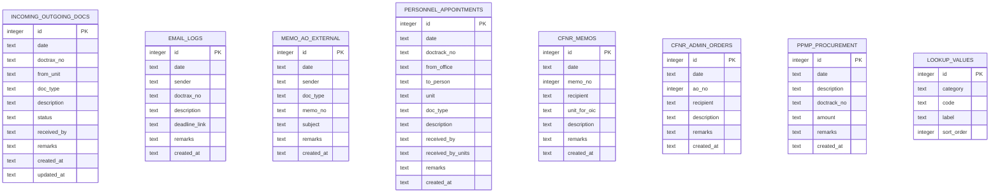

# DO-DocTrax: CFNR Dean's Office Document Tracking System
## Technical Specification & Implementation Roadmap

---

## 1. Project Overview & Objectives

**DO-DocTrax** is a lightweight, responsive web application designed for the **Dean's Office (DO) of the College of Forestry and Natural Resources (CFNR) at UP Los Baños (UPLB)**. 

It replaces the legacy, cumbersome Excel tracking workbook (`COMMUNICATIONS & DOCUMENTS RECEIVED 2025.xlsx`) with a modern, high-performance local web dashboard backed by a zero-configuration **SQLite** database.

### Core Objectives
1. **Zero-Friction Minimal Install:** Runs locally on Windows using Python's built-in standard library (`sqlite3` and `http.server`), requiring **no complex database servers**, no Docker, and no Node.js runtime build steps.
2. **Data Integrity & Speed:** Replaces file-locking issues with ACID-compliant SQLite storage capable of sub-millisecond queries across 6,000+ historical transactions.
3. **Seamless Office Compatibility:** Includes 1-click historical Excel import and 1-click export back to the exact multi-sheet `.xlsx` format required by university administration.
4. **Enhanced Quality of Life (QoL):** Provides real-time search, color-coded status tracking, smart pickup/custody timestamp shortcuts, and live KPI analytics to replace static pivot tables.
5. **Human-Crafted Visual Polish:** Designed following the `impeccable` design principles (clean visual hierarchy, high contrast, responsive data grids, accessible controls, and purposeful micro-interactions).

---

## 2. Technology Stack & Zero-Dependency Architecture

| Component | Technology | Rationale |
| :--- | :--- | :--- |
| **Database** | **SQLite 3** (`doctrax.db`) | Built directly into Python (`sqlite3`). Zero installation, single file, ACID compliant, handles millions of rows effortlessly. |
| **Backend** | **Python 3.12 (Standard Library)** | Built-in `http.server`, `sqlite3`, `json`, and `urllib`. Requires **zero `pip install`** dependencies to run the server. |
| **Excel I/O** | **`openpyxl`** | Already installed in the local Python environment for robust `.xlsx` migration and export. |
| **Frontend Shell** | **HTML5 & Vanilla CSS3** | Zero build steps (no Vite/Webpack/Node required). Fast load times and predictable styling using CSS custom properties (variables). |
| **Frontend Logic** | **Modern ES6+ JavaScript** | Modular, predictable state management, native `fetch` API, no external front-end framework bloat. |
| **Desktop Launcher**| **Windows Batch (`run.bat`)** | One-click double-clickable launcher that starts the local server and automatically opens the browser. |

---

## 3. Database Schema (SQLite)

The SQLite database (`doctrax.db`) maps directly to the operational workflows identified in the 2025 tracking logbook:



### Controlled Vocabulary (Pre-seeded in `LOOKUP_VALUES`):
* **Units:** `DO` (Dean's Office), `OCS`, `OCREL`, `LIB`, `SFFG`, `FBS`, `FPPS`, `IRNR`, `FDC`, `IAF`, `MCME`, `TREES`, `INREM`.
* **Document Types (35 standard types):** *Authority to Fill, Travel Request, Letter Request, Basic Paper, Monthly Report of Attendance, Trip Ticket, MOA, MOU, IPCR, OPCR, Leave Form, etc.*
* **Appointment Types:** *NOSA, TEMPORARY APPOINTMENT, NOTICE OF STEP INCREMENT, APPROVED APPOINTMENT, APPROVAL OF PROMOTION, RETIREMENT LETTER.*
* **Standard Statuses:** `SIGNED`, `FOR REVIEW`, `FOR APPROPRIATE ACTION`, `FOR COMMENTS`, `APPROVED`, `DISAPPROVED`, `RETURNED`.

---

## 4. Key Quality-of-Life (QoL) Features

### 4.1 Fast Search & Faceted Filtering
* **Instant Global Search:** Real-time search across Doctrax numbers, descriptions, personnel names, and remarks without UI freeze.
* **Filter Bar:** Quick filtering by Unit, Document Type, Status, and Date Range (Today, This Week, This Month, Custom).

### 4.2 Smart Data Entry & Custody Tracking
* **One-Click Pick-up / Courier Timestamping:** Instead of repeatedly retyping `"pick up by Kuya Paolo 01/03/2025"` or `"c/o Ms. April"`, staff can pick a courier from a quick dropdown and click **"Stamp Picked Up"** to automatically insert the courier's name and today's date.
* **Auto-Suggest & History:** Autocomplete for frequent recipient names and descriptions based on previously logged records.
* **Duplicate / Clone Record:** 1-click clone button to rapidly enter batches of appointments or recurring travel requests.
* **Doctrax Input Formatting:** Automatic validation for standard UPLB tracking numbers (`YYYYMM-XXXXXX`).

### 4.3 Live Operational Dashboard (Analytics)
* **Real-time KPI Tiles:** 
  - Total Documents Logged (Year-to-Date & Monthly)
  - Pending Review / For Action count
  - Email Deadlines count
  - Appointments / NOSAs Released
* **Dynamic Distribution Charts:** Visual representation of document volume by Unit (`FDC`, `MCME`, `DO`, `IRNR`) and monthly routing trends (replacing Excel pivot sheets `Sheet2`–`Sheet5`).

### 4.4 Data Portability & Safety
* **Initial Migration Script:** Parses `COMMUNICATIONS & DOCUMENTS RECEIVED 2025.xlsx` and seeds the SQLite database with all 5,700+ historical entries in seconds.
* **1-Click Full Export:** Generates a matching multi-sheet `.xlsx` file on-demand anytime for administrative backups or sharing with non-web users.
* **Automated Daily Backups:** Simple copy of `doctrax.db` to a `backups/` directory with date stamping.

---

## 5. Suggested File Structure

```
do-doctrax/
├── do_doctrax_specification.md     # This comprehensive specification
├── COMMUNICATIONS & DOCUMENTS RECEIVED 2025.xlsx  # 2025 Source Excel File
├── doctrax.db                      # Local SQLite database file (created on init)
├── server.py                       # Zero-install Python HTTP & SQLite REST API
├── run.bat                         # Desktop double-click launcher
├── scripts/
│   ├── migrate_excel_to_sqlite.py  # One-time migration / seed script
│   └── export_sqlite_to_excel.py   # Database to Excel exporter
└── public/
    ├── index.html                  # Main application layout and modal containers
    ├── css/
    │   ├── style.css               # Design tokens, layout, and component styling
    │   └── theme.css               # Color palettes (modern dark & light modes)
    └── js/
        ├── app.js                  # App bootstrap, tab router, and state
        ├── api.js                  # Fetch wrapper for SQLite REST endpoints
        ├── table.js                # High-performance data table rendering & pagination
        ├── form.js                 # Validation, auto-suggest, and custody stamper
        └── stats.js                # Live KPI calculation and SVG charts
```

---

## 6. Implementation Checklist & Milestones

### Phase 1: Database Setup & Data Migration
- [x] **Task 1.1:** Write `scripts/migrate_excel_to_sqlite.py` to create `doctrax.db` with all tables and indexes.
- [x] **Task 1.2:** Ingest and parse all 7 operational sheets from `COMMUNICATIONS & DOCUMENTS RECEIVED 2025.xlsx` into SQLite.
- [x] **Task 1.3:** Seed `LOOKUP_VALUES` table with standard units, document types, and statuses from `Sheet1`.
- [x] **Task 1.4:** Verify row count integrity against Excel records (ensuring ~5,740 records migrate cleanly).

### Phase 2: Lightweight Python Server (Zero Install)
- [x] **Task 2.1:** Build `server.py` using Python standard library `http.server` and `sqlite3`.
- [x] **Task 2.2:** Implement REST endpoints:
  - `GET /api/documents` (with query parameters: `category`, `search`, `unit`, `status`, `page`, `limit`)
  - `POST /api/documents` (create new transaction)
  - `PUT /api/documents/{id}` (update record)
  - `DELETE /api/documents/{id}` (soft/hard delete)
  - `GET /api/lookups` (dropdown options for units, doc types, statuses)
  - `GET /api/stats` (KPI counts & unit volume metrics)
  - `GET /api/export` (triggers Excel export)
- [x] **Task 2.3:** Create `run.bat` for one-click startup on Windows.

### Phase 3: Frontend Interface & Layout
- [x] **Task 3.1:** Build semantic HTML shell in `public/index.html` with sidebar/tabs for each document category:
  1. *Incoming & Outgoing Documents*
  2. *Email Communications*
  3. *University Memos & Admin Orders*
  4. *Appointments & NOSAs*
  5. *CFNR Internal Memos & Admin Orders*
  6. *PPMP / Procurement*
- [x] **Task 3.2:** Apply `impeccable` design principles in `public/css/style.css` (institutional Public Sans typography, WCAG AA contrast, structured layout, responsive table).
- [x] **Task 3.3:** Implement KPI Summary Cards at the top of each view.

### Phase 4: Data Grid & Search Capabilities
- [x] **Task 4.1:** Build modular table renderer in `public/js/app.js` with virtual pagination (fast rendering of large lists).
- [x] **Task 4.2:** Implement real-time debounced global search and category filters.
- [x] **Task 4.3:** Add visual status badges with color coding (Green for `SIGNED`, Yellow for `FOR REVIEW`, Blue for `FOR ACTION`, Red for `RETURNED`).

### Phase 5: Smart Entry Forms & Quality of Life
- [x] **Task 5.1:** Build modal data entry and edit forms with pre-populated dropdowns.
- [x] **Task 5.2:** Implement the **One-Click Custody/Pick-up Stamper** shortcut.
- [x] **Task 5.3:** Implement **Clone Record** functionality for rapid recurring entries.
- [x] **Task 5.4:** Implement input validation (date formats, required fields, Doctrax format).

### Phase 6: Reporting & Excel Export
- [x] **Task 6.1:** Build `scripts/export_sqlite_to_excel.py` to regenerate the full multi-sheet `.xlsx` file matching the original format.
- [x] **Task 6.2:** Add front-end "Export to Excel" button with download progress feedback.
- [x] **Task 6.3:** End-to-end testing of data entry, search, edit, and export workflows.

