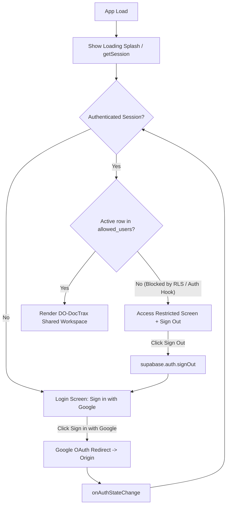

# DO-DocTrax Auth Architecture: Supabase Google OAuth + Multi-User Whitelist (RLS)

This document defines the authentication and access-control architecture for **CFNR DO-DocTrax** when deployed on the internet. It replaces the previous React/Vite single-user draft with a zero-build **Static HTML5 + Vanilla JS + Supabase** design tailored for a shared Dean's Office team.

> Track implementation progress step-by-step in [login_implementation_checklist.md](./login_implementation_checklist.md).

---

## 1. Architecture Overview

DO-DocTrax uses **Supabase Auth (Google OAuth)** and **Supabase PostgreSQL Row-Level Security (RLS)** so authorized office staff can securely share one database over HTTPS without managing a custom backend server:

1. **Google OAuth Sign-In (`signInWithOAuth`)**: Staff sign in using their authorized Google account (`@up.edu.ph` or approved `@gmail.com`). Sessions persist in browser storage and refresh tokens automatically.
2. **Database-Enforced Multi-User Whitelist (`allowed_users`)**: Instead of a client-side single-email variable, authorized staff emails live in a PostgreSQL `allowed_users` table with `role` (`admin`, `staff`, `viewer`) and `is_active` flags.
3. **Shared Workspace RLS (Not Per-User Isolation)**: All 8 DO-DocTrax tables are shared across authorized Dean's Office staff. Every `SELECT`, `INSERT`, `UPDATE`, and `DELETE` is gated at the database engine level by `public.is_allowed_user()`.
4. **No Unauthenticated Offline Bypass**: Because DO-DocTrax is a shared multi-user logbook on the public internet, unauthenticated visitors cannot enter an offline/local-storage mode.

---

## 2. Dependencies & Public Client Config

### SDK Loading (Zero-Build Vanilla JS)
Load `@supabase/supabase-js` v2 directly via ESM CDN in `public/index.html` (no `npm` or Vite build step required):

```html
<script type="module" src="js/auth.js"></script>
<script type="module" src="js/app.js"></script>
```

### Public Client Config (`public/js/config.js`)
Only the public Project URL and Publishable / `anon` key belong in browser code—**never** include the `service_role` key:

```js
export const SUPABASE_URL = 'https://your-project-id.supabase.co';
export const SUPABASE_ANON_KEY = 'your-anon-or-publishable-key';
```

---

## 3. Target File Structure

```text
public/
├── index.html               # App shell, Login/Restricted gate containers, Header user menu
├── css/
│   └── style.css            # Existing CFNR styles + Login/Restricted screen styles
└── js/
    ├── config.js            # SUPABASE_URL and SUPABASE_ANON_KEY
    ├── auth.js              # Supabase client, Google OAuth, session listener, allowed_users check
    └── app.js               # Main DocTrax UI & Supabase data queries (runs only after auth gate passes)
supabase_schema.sql          # allowed_users, 8 DocTrax tables, audit columns, helper functions & RLS
```

---

## 4. State Flow



---

## 5. Implementation Specification

### A. Auth Module (`public/js/auth.js`)
- Import `createClient` from `@supabase/supabase-js` (ESM) and credentials from `./config.js`.
- Initialize `supabase`:
  ```js
  export const supabase = createClient(SUPABASE_URL, SUPABASE_ANON_KEY, {
    auth: {
      persistSession: true,
      autoRefreshToken: true,
      detectSessionInUrl: true,
    },
  });
  ```
- Export `signInWithGoogle()`:
  ```js
  const { error } = await supabase.auth.signInWithOAuth({
    provider: 'google',
    options: {
      redirectTo: window.location.origin,
    },
  });
  if (error) throw error;
  ```
- Export `signOut()`: calls `await supabase.auth.signOut()`.
- Export `getAuthorizedProfile(session)`:
  - If `!session?.user?.email` → return `null`.
  - Query `allowed_users` for `lower(email)` matching `session.user.email` with `is_active = true`.
  - Returns `{ email, full_name, role }` if authorized, or `null` if not whitelisted.

### B. App Gate (`public/index.html` + `public/js/auth.js`)
Control three mutually exclusive top-level views:
1. **Loading Splash (`#auth-loading`)**: Shown on initial load until `getSession()` + `getAuthorizedProfile()` finish.
2. **Auth Gate (`#auth-gate`)**:
   - **State A (Not signed in)**: CFNR-branded card with **"Sign in with Google"** button, loading state, and error display.
   - **State B (Signed in, `profile === null`)**: **"Access Restricted"** card displaying the signed-in email and a **"Sign Out & Switch Account"** button.
3. **Main Workspace (`.app-container`)**: Shown only when `session` exists **and** `profile !== null`.

### C. Header User Menu (`public/index.html`)
In the authenticated top header:
- Display the signed-in user's Google avatar (or initials), `full_name`, `email`, and `role` badge (`Admin` / `Staff`).
- Provide a **Sign Out** button wired to `signOut()`.
- Optionally show a **"Manage Access"** button for `role === 'admin'` to add or deactivate staff emails in `allowed_users`.

### D. Database Whitelist & Shared-Team RLS (`supabase_schema.sql`)
1. **Whitelist table (`public.allowed_users`)**:
   ```sql
   create table public.allowed_users (
     id uuid primary key default gen_random_uuid(),
     email text not null unique,
     full_name text,
     role text not null default 'staff' check (role in ('admin', 'staff', 'viewer')),
     is_active boolean not null default true,
     created_at timestamptz not null default now()
   );
   ```
2. **Security helper functions**:
   ```sql
   create or replace function public.is_allowed_user()
   returns boolean
   language sql
   security definer
   stable
   as $$
     select exists (
       select 1
       from public.allowed_users
       where lower(email) = lower(coalesce(auth.jwt() ->> 'email', ''))
         and is_active = true
     );
   $$;

   create or replace function public.is_admin()
   returns boolean
   language sql
   security definer
   stable
   as $$
     select exists (
       select 1
       from public.allowed_users
       where lower(email) = lower(coalesce(auth.jwt() ->> 'email', ''))
         and role = 'admin'
         and is_active = true
     );
   $$;
   ```
3. **Shared RLS policies on every DocTrax table** (`incoming_outgoing_docs`, `email_logs`, `memo_ao_external`, `personnel_appointments`, `cfnr_memos`, `cfnr_admin_orders`, `ppmp_procurement`, `lookup_values`):
   ```sql
   alter table public.<table_name> enable row level security;

   create policy "Authorized staff can access <table_name>"
     on public.<table_name>
     for all
     using (public.is_allowed_user())
     with check (public.is_allowed_user());
   ```
   *(If `viewer` role or `admin`-only `DELETE` is desired, split `for all` into separate `SELECT`, `INSERT`, `UPDATE`, and `DELETE` policies.)*

---

## 6. Important Security & Setup Notes

- **Supabase Dashboard Setup**: Enable **Google** under *Authentication → Providers → Google* using your Google Cloud OAuth Client ID & Secret, and register your production HTTPS URL (plus `http://localhost:8000` for testing) under *Authentication → URL Configuration → Redirect URLs*.
- **Backend Rejection (Defense in Depth)**: RLS already blocks non-whitelisted accounts from reading or writing any table even via direct API calls. For extra strictness, add a Supabase **Before User Created** Auth Hook that rejects sign-up attempts for emails not listed in `allowed_users`.
- **Audit Trail**: Populate `created_by` and `updated_by` (from the authenticated user's email) and `updated_at` on document inserts, edits, and custody pickup stamps.
