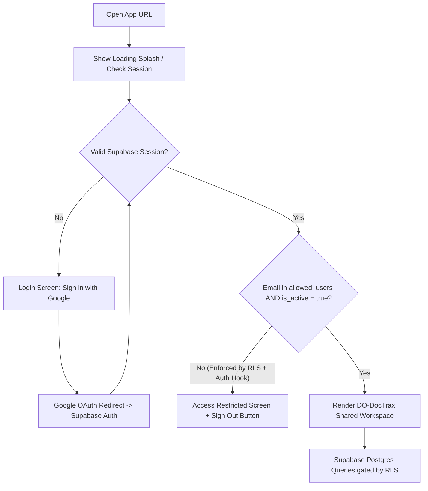

# DO-DocTrax Internet Deployment & Login Implementation Checklist

This document defines the target authentication and cloud database structure for making **CFNR DO-DocTrax** accessible over the internet to authorized Dean's Office staff, adapting [login_architecture.md](./login_architecture.md) for a multi-user shared logbook.

> **Key Architectural Decisions**
> - **Auth + Database:** Use **Supabase Auth (Google OAuth)** + **Supabase PostgreSQL** instead of Google Sheets as a database or runtime login whitelist.
> - **Multi-User Shared Access:** Replace single-user `VITE_ALLOWED_EMAIL` and `auth.uid() = user_id` isolation with a database-enforced `allowed_users` whitelist table and **Row-Level Security (RLS)** policies.
> - **Stack Alignment:** `do-doctrax` currently runs as Static HTML5 + Vanilla JS (`public/index.html`, `public/js/app.js`) backed by Python/SQLite (`server.py`, `doctrax.db`). This checklist keeps the zero-build Vanilla JS frontend (loading `@supabase/supabase-js` via ESM/CDN) while replacing local `server.py` API calls with Supabase queries.

---

## Target Login & Data Flow

---

## Progress Overview

| Phase | Focus | Status |
| :--- | :--- | :--- |
| **Phase 1** | Google OAuth & Supabase Project Setup | `[x] Done` |
| **Phase 2** | Postgres Schema, `allowed_users` Whitelist & RLS Policies | `[x] Done` |
| **Phase 3** | Data Migration (`doctrax.db` → Supabase) & Excel Export | `[~] Migrated (Run setval SQL)` |
| **Phase 4** | Frontend Auth Gate & Login UI (`public/`) | `[x] Done (4.1–4.3)` |
| **Phase 5** | Replace Local API Calls (`public/js/app.js` → Supabase) | `[x] Done` |
| **Phase 6** | Security Testing, Hosting & Cutover | `[ ] Not Started` |

---

## Phase 1: Cloud & Auth Foundation (Google Cloud + Supabase)

- [x] **1.1 Create Supabase Project**
  - Project created (`https://hfvozfjnezkmsqywwgpt.supabase.co`) and Publishable key saved in `public/js/config.js` (no `service_role` / `sb_secret` key in `public/`).
- [x] **1.2 Configure Google Cloud OAuth 2.0**
  - In Google Cloud Console (personal `@gmail.com` account), create/configure an **External** OAuth Consent Screen (**Google Auth Platform → Branding / Audience**).
  - Create **OAuth 2.0 Client ID** (Web application).
  - Add `http://localhost:8000` to **Authorized JavaScript origins**.
  - Add Supabase's callback URL (`https://hfvozfjnezkmsqywwgpt.supabase.co/auth/v1/callback`) to **Authorized redirect URIs**.
- [x] **1.3 Enable Google Provider in Supabase Auth**
  - Paste Google Client ID & Client Secret in **Authentication → Providers → Google**.
  - Add allowed app origins (e.g., `http://localhost:8000` for testing and your production HTTPS domain) under **Authentication → URL Configuration → Redirect URLs**.
- [x] **1.4 Decide Sign-Up Policy**
  - Configure strict access control so random internet users cannot access data even if they pass Google login (see Phase 2 whitelist + Auth Hook).

---

## Phase 2: Database Schema, Multi-User Whitelist & RLS (`supabase_schema.sql`)

- [x] **2.1 Create `allowed_users` Table**
  - Columns: `id` (uuid PK), `email` (text unique, lowercase-normalized), `full_name` (text), `role` (`'admin' | 'staff' | 'viewer'`), `is_active` (boolean default `true`), `created_at` (timestamptz).
  - Seed initial Dean's Office admin & staff email addresses.
- [x] **2.2 Create Security Helper Functions in Postgres**
  - Create `public.is_allowed_user()` (`SECURITY DEFINER`) returning `true` only when `auth.jwt() ->> 'email'` matches an `is_active = true` row in `allowed_users` (case-insensitive).
  - Create `public.is_admin()` (`SECURITY DEFINER`) checking `role = 'admin'` and `is_active = true`.
- [ ] **2.3 (Optional) Add Supabase Auth Hook / Pre-Signup Gate**
  - Add a **Before User Created** Auth Hook (or Postgres trigger/Edge Function) that rejects sign-ups for emails not present in `allowed_users`, blocking unauthorized accounts before a user record is even created.
- [x] **2.4 Migrate All 8 `doctrax.db` Tables to Postgres**
  - `incoming_outgoing_docs`
  - `email_logs`
  - `memo_ao_external`
  - `personnel_appointments`
  - `cfnr_memos`
  - `cfnr_admin_orders`
  - `ppmp_procurement`
  - `lookup_values`
  - Add audit columns on operational tables (`created_by`, `updated_by`, `updated_at`) so the team can see which staff member logged or updated a record.
- [x] **2.5 Add Indexes for Fast Search**
  - Recreate indexes for `date`, `doctrax_no`/`doctrack_no`, `from_unit`/`unit`, `status`, `sender`, and `to_person` (plus trigram/GIN indexes if using `ILIKE` search across descriptions).
- [x] **2.6 Enable & Verify Row-Level Security (RLS) on Every Table**
  - Enable RLS (`ALTER TABLE ... ENABLE ROW LEVEL SECURITY;`) on `allowed_users` and all 8 document/lookup tables.
  - Operational tables (`SELECT`, `INSERT`, `UPDATE`, `DELETE`): allow only when `public.is_allowed_user()` is `true` (and optionally restrict `DELETE` to `public.is_admin()`).
  - `allowed_users` table: users can `SELECT` their own row (`lower(email) = lower(auth.jwt() ->> 'email')`); only `public.is_admin()` can insert/update/deactivate staff emails.
- [ ] **2.7 (Optional) Google Sheet → `allowed_users` Sync**
  - *Only if admins prefer managing emails in a restricted Google Sheet:* set up a scheduled or `onEdit` Google Apps Script that pushes email changes to a protected Supabase Edge Function (using a secret token) to update `allowed_users`—never query Google Sheets directly from the browser.

---

## Phase 3: Data Migration & Excel Compatibility

- [~] **3.1 Write One-Time Migration Script (`doctrax.db` → Supabase Postgres)**
  - [x] Created `scripts/migrate_sqlite_to_supabase.py` and uploaded all 10,271 rows from `doctrax.db` to Supabase.
  - [ ] Run the 8 `select setval(...)` lines in Supabase SQL Editor (`postgres` role) to sync auto-increment IDs.
- [x] **3.2 Verify Row Counts & Lookups**
  - All 8 tables verified matching (`incoming_outgoing_docs`: 3588, `email_logs`: 4433, `memo_ao_external`: 524, `personnel_appointments`: 1225, `cfnr_memos`: 416, `cfnr_admin_orders`: 7, `ppmp_procurement`: 9, `lookup_values`: 69).
- [x] **3.3 Maintain Excel (`.xlsx`) Export Compatibility**
  - Created `scripts/export_supabase_to_excel.py` (matches the official 7-sheet `.xlsx` format).
  - Added browser-side `.xlsx` export in `public/js/app.js` (`handleExportExcel`) using SheetJS so `#btn-export-excel` works without Python.

---

## Phase 4: Frontend Auth Gate & Login UI (`public/`)

- [x] **4.1 Add Supabase Client Config (`public/js/config.js` & `public/js/auth.js`)**
  - [x] Created `public/js/config.js` with `SUPABASE_URL` and `SUPABASE_PUBLISHABLE_KEY`.
  - [x] Load `@supabase/supabase-js` via ESM/CDN (no Vite/npm build required) in `public/js/auth.js`.
  - [x] Initialize `createClient(SUPABASE_URL, SUPABASE_PUBLISHABLE_KEY, { auth: { persistSession: true, autoRefreshToken: true, detectSessionInUrl: true } })`.
  - [x] Expose `signInWithGoogle()`, `signOut()`, `getSession()`, `getProfile()`, and whitelist verification (`fetchAuthorizedProfile()`).
- [x] **4.2 Build Login & Gate Views (`public/index.html` + `public/css/style.css`)**
  - **Loading State:** Full-screen loading splash while `getSession()` resolves (prevents flashing the dashboard before auth checks finish).
  - **Sign-In State (Unauthenticated):** CFNR-branded login card (matching `DESIGN.md` forest green/parchment palette) with **"Sign in with Google"** button, loading indicator, and error alert.
  - **Access Restricted State (Signed in, not in `allowed_users` or inactive):** Show the signed-in email, explain that access is restricted to authorized CFNR Dean's Office personnel, and provide a **"Sign Out & Switch Account"** button.
  - **Remove Public "Continue Offline" Bypass:** Do not allow unauthenticated internet visitors to click into an offline mode that pretends to log office records.
- [x] **4.3 Update Top Header (`public/index.html`)**
  - Display signed-in user's avatar/initials, name, and role badge (`ADMIN` / `STAFF` / `VIEWER`).
  - Add a **Sign Out** button.
  - Removed local-only **"Share on Wi-Fi"** (`#btn-share-network`).
- [ ] **4.4 (Optional) In-App Staff Access Management Modal**
  - Visible only to `role = 'admin'` users to add/deactivate allowed emails in `allowed_users` without opening the Supabase Dashboard.

---

## Phase 5: Replace Local `server.py` Calls (`public/js/app.js` → Supabase)

- [x] **5.1 Guard All Data Operations on Verified Session**
  - `public/js/app.js` waits for `doctrax:authorized` and validates `getSupabaseClient()` + `canCurrentUserWrite()` before any query/mutation.
- [x] **5.2 Replace Local REST Endpoints with Supabase Queries**
  - `loadLookups()` → `supabase.from('lookup_values').select(...)`
  - `loadStats()` → parallel `{ count: 'exact', head: true }` queries across all 7 tables + status KPI counts
  - `loadDocuments()` → paginated `.range(fromIdx, toIdx)` with `.or(...ilike...)` search, unit filter, and status filter
  - `handleDocumentFormSubmit()` / `handleDeleteRecord()` → `insert` / `update` / `delete` with `created_by` and `updated_by` populated from the signed-in user
  - `handleApplyCustodyStamp()` → updates `received_by` / `received_by_units` + `updated_by`
  - `handleExportExcel()` → browser-side SheetJS `.xlsx` generation across all 7 tables
- [x] **5.3 Handle Session Expiry & RLS Errors**
  - `handleSupabaseError()` catches `401` / `PGRST301` (signs out cleanly) and `403` / `42501` (displays RLS permission toast).

---

## Phase 6: Security Hardening, Deployment & Verification

- [ ] **6.1 Deploy Static Frontend over HTTPS**
  - Host `public/` on a static HTTPS provider (e.g., Cloudflare Pages, Vercel, Netlify, or GitHub Pages).
  - Verify custom/production domain is added to Supabase **Redirect URLs** and Google OAuth **Authorized JavaScript origins**.
- [ ] **6.2 Security Audit (Must Pass Before Sharing URL)**
  - [ ] Confirm **no `service_role` key** or database password exists anywhere in `public/` or git history.
  - [ ] Log in with a **non-whitelisted personal Gmail** → confirm the UI shows **"Access Restricted"** and **cannot** read or write any records.
  - [ ] Test **direct Supabase REST API access** (using `curl` or browser DevTools with the `anon` key and a non-whitelisted user JWT) → confirm RLS blocks all 8 tables (`[]` / `401` / `403`).
  - [ ] Confirm **unauthenticated requests** (no JWT) cannot read `allowed_users` or any document table.
- [ ] **6.3 Operational & Concurrency Testing**
  - [ ] Log in simultaneously with two different whitelisted staff accounts on separate browsers/devices; create a record and apply a custody stamp, and confirm both see consistent data.
  - [ ] Verify Excel export produces a valid `.xlsx` workbook matching existing office templates.
  - [ ] Document backup & admin onboarding steps (how to add/remove a staff email when someone joins or leaves the Dean's Office).

